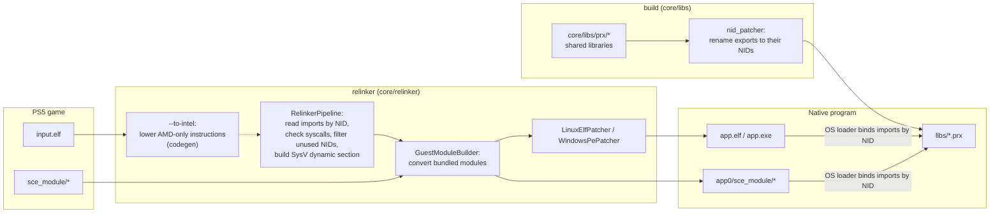
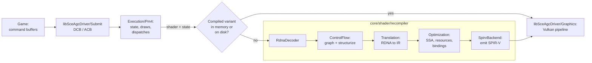

# Architecture

How a PS5 executable becomes a native Linux or Windows program. Nothing is emulated: the converted executable runs as a normal process and calls native implementations of the system libraries.

## Overview

- [`core/relinker/main.cpp`](../../core/relinker/main.cpp) runs the steps in this order. `--to-intel` is optional, see [USAGE.md](../user/USAGE.md).
- Each library in [`core/libs/prx`](../../core/libs/prx) builds as a shared library. After the build, `nid_patcher` ([`core/libs/nid`](../../core/libs/nid)) renames every export to its NID, computed from the function name. `APS5_EXPORT("<nid>", func)` sets the NID directly when the name is unknown.

## Graphics

- [`Recompiler.cpp`](../../core/shader/recompiler/Recompiler.cpp) runs the stages in this order. With `ANYPS5_ENABLE_SPIRV_TOOLS`, the SPIR-V is also validated and optimized with SPIRV-Tools.
- `ShaderRecompiler::Recompile` keeps compiled variants in memory, and `ShaderDiskCache` stores them on disk so later runs reuse them.

## Experimental macOS path

[`core/host/arm64`](../../core/host/arm64) maps static ELF segments into checked guest memory,
decodes a subset of x86-64 integer instructions, and emits ARM64 basic blocks into an Apple
Silicon JIT arena. Guest branches return to the CPU dispatcher, which caches translated blocks.
Guest code bytes are data and are never executed directly. Native callback bindings translate
integer arguments from the guest SysV registers and stack into an ARM64 C++ call.

[`core/host/metal`](../../core/host/metal) converts the shader recompiler's SPIR-V to MSL and
uses Metal directly for GPU compilation and commands. The CPU-to-Metal test exercises a guest
call to a native callback, GPU compute/RDNA rendering, and guest-memory readback. This is not an AGC export or
a running title. Dynamic imports, the full guest CPU/PRX ABI, and the game graphics driver are
not integrated; see [technical debt](TechnicalDebt.md#build).
